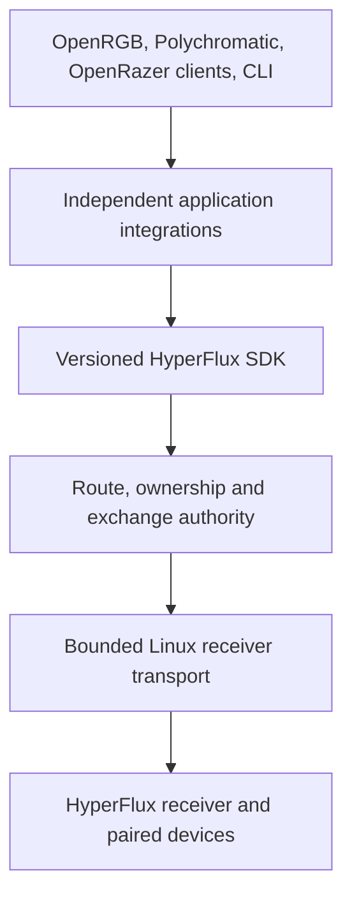
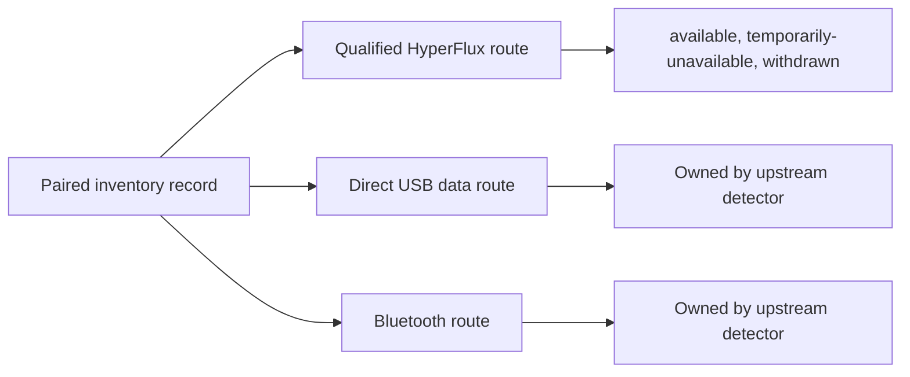
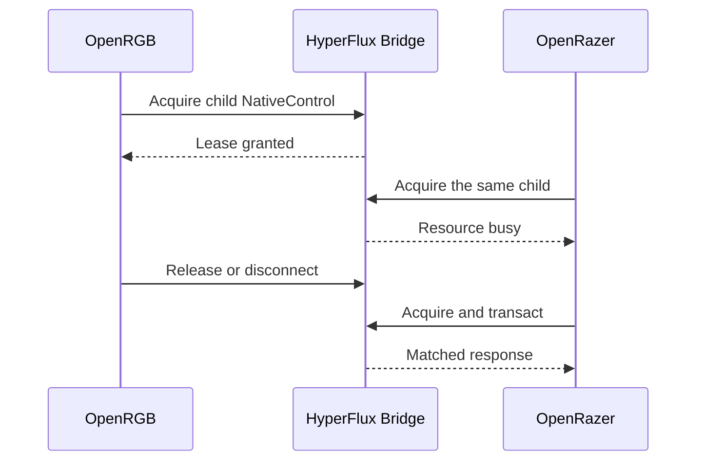

# HyperFlux Next Design Book

This book records the architecture shipped by HyperFlux Next 2.0. Each subject states a
current boundary or invariant. Explicitly labeled future work is non-shipping direction,
not a promise of support.

- [I. Product Foundations](#chapter-i-product-foundations)
- [II. Architectural Foundation](#chapter-ii-the-architectural-foundation)
- [III. Devices, Routes And Truthful State](#chapter-iii-devices-routes-and-truthful-state)
- [IV. Universality And Qualification](#chapter-iv-universality-and-qualification)
- [V. Application Integrations](#chapter-v-application-integrations)
- [VI. Application Ownership](#chapter-vi-application-ownership)
- [VII. Schemas, SDKs And Reuse](#chapter-vii-schemas-sdks-and-reuse)
- [VIII. Simulation And Verification](#chapter-viii-simulation-and-verification)
- [IX. User Experience And Diagnostics](#chapter-ix-user-experience-and-diagnostics)
- [X. Updates, Packaging And Operations](#chapter-x-updates-packaging-and-operations)
- [XI. Automation, Documentation And GitHub](#chapter-xi-automation-documentation-and-github)
- [XII. Release Boundaries](#chapter-xii-release-boundaries)

## Chapter I: Product Foundations
### 1. Purpose
HyperFlux Next is the Linux bridge for devices paired through HyperFlux V2. Core provides the receiver driver, bridge, SDK, CLI, and base services. Full adds the OpenRazer compatibility transport and OpenRGB integration used by optional stock applications. Capability-based profiles allow mouse-only, keyboard-only, mixed-device, and no-RGB-application installations without machine-specific binding.
### 2. Relationship To Earlier Implementations
HyperFlux Next 2.0 keeps verified behavior while replacing accidental coupling with explicit boundaries, schemas, and generated projections. Earlier implementation details are not public product authority. Current profiles, source-bound catalogs, tests, and release evidence are the maintained sources of truth.
### 3. Knowledge That Must Be Preserved
Maintained claims link to source authority, tests, or privacy-safe physical evidence. Receiver framing, qualified identities, LED mappings, generation rules, battery semantics, lifecycle behavior, package behavior, and application layouts remain reviewable facts rather than unexplained constants.
### 4. Complexity That Must Not Be Preserved
The public product rejects duplicated constants, absolute machine paths, exact local-device combinations, handwritten copies of upstream inventories, and hidden coupling between application presentation and transport policy. Compatibility is preserved through stable interfaces and evidence; accidental implementation structure is not.
## Chapter II: The Architectural Foundation
### 5. Primary Architecture
The system requires a strict direction of responsibility. OpenRazer and OpenRGB keep the model-specific commands, capabilities, settings, layouts, effects, and persistence they already use for direct devices. HyperFlux replaces only the missing route through the receiver: it qualifies the child, arbitrates one native owner, carries one fixed upstream Feature report, and returns the matching response without interpreting device semantics.



This structure gives us replaceable applications above a stable hardware foundation. Upstream applications continue to construct standard Razer reports, while the SDK hides local framing and the bridge and kernel hide receiver generations, carrier transport, correlation, and failure certainty.
### 6. Kernel Responsibility
The kernel driver performs only work that requires kernel access: binding verified HID interfaces, preserving ordinary mouse and keyboard input, managing receiver generations, exposing passive observations, enforcing one exclusive writer session, and transporting bounded generation-scoped exchanges. UAPI v2 accepts exactly one qualified 90-byte Feature report, begins its SET at most once, acquires one bounded matching response, and reports transport certainty. Effects, product names, application ownership, profile migration, notifications, package repair, and artwork remain outside the kernel.
### 7. Bridge Responsibility
The bridge is the sole userspace authority allowed to request receiver writes. For the native path it validates the exact route token, receiver generation, declarative report profile, NativeControl ownership, fixed report shape, deadline, queue admission, and response correlation. It reports only `not-sent`, `may-have-been-sent`, or `matched-response` and never converts a device status into success or repeats an uncertain SET. Because every application passes through the same bridge, route safety is implemented once while model behavior remains upstream.
### 8. Strong Domain Types
`GenerationId`, `ReceiverId`, `LogicalDeviceId`, `RouteToken`, `EndpointId`, `LeaseId`, `TransactionId`, `ProductId`, `BatteryPercent`, and `DurationMs` are distinct validated domain types. This prevents a battery value from becoming brightness, a stale generation from authorizing a current route, or a wired PID from silently authorizing a wireless child.
## Chapter III: Devices, Routes And Truthful State
### 9. Inventory And Routes
A paired inventory record and a currently authorized route are different objects. One keyboard may be known to the receiver while direct USB, HyperFlux wireless, or Bluetooth data paths change independently.



This distinction prevents paired history from becoming write authority. Inventory can remain useful for diagnostics while a withdrawn HyperFlux route produces no virtual controller. HyperFlux availability does not claim sleep, power-off, physical readiness, or visible application state.
### 10. Presence State Model
Native route state is deliberately smaller than retail-device state. `available` grants a generation-bound route after explicit route evidence or qualified endpoint-local traffic, `temporarily-unavailable` retains a known identity without accepting a transaction, and `withdrawn` records actual removal from the route inventory or generation. Pairing, silence, sleep labels, power labels, passive battery observations, and input activity remain separate facts unless a profile explicitly qualifies the endpoint-local report as route evidence. HyperFlux never promises that availability proves the child will visibly apply a command.
### 11. Wired And Wireless Duplicate Handling
OpenRGB and OpenRazer own direct USB devices, while their HyperFlux transport adapters own receiver-backed routes. Direct USB takes precedence only when a nonempty serial queried from the physical direct route exactly matches the receiver-backed child. HyperFlux withdraws that one virtual route and recreates it after the direct data route disappears. It never deduplicates by PID, model name, or device kind, and a wall-power cable without a data route changes nothing.
### 12. Composable Hardware Profiles
A qualified receiver profile describes receiver behavior, and independent child profiles describe each keyboard or mouse. Runtime composition uses whichever qualified children are actually paired. No exact keyboard-plus-mouse combination is required.
### 13. Hard And Cloth Editions
Hard and Cloth are surface variants, not guessed USB identities. Shared protocol and PID facts remain in the receiver profile; a future evidence-backed behavioral difference can add a narrow variant override. A product name or one physically tested edition never invents identity for another edition.
### 14. Mat And Receiver Presentation
HyperFlux V2 is not published as an addressable RGB controller unless an upstream application has a real controller and qualified standard report path for it. Charging, pairing, transport, identity, and diagnostics do not invent a third lighting device. Any future controllable status light requires a source-bound upstream model and qualified native route.
## Chapter IV: Universality And Qualification
### 15. Support Levels
Support must distinguish upstream model support from HyperFlux transport qualification. A device may be a reviewed candidate or have extensive OpenRazer and OpenRGB knowledge while its receiver route remains non-writable. A native route becomes qualified only when exact receiver-observed identity, source-bound upstream records, a matching fixed report family, response correlation, and physical transport evidence agree. Upstream applications decide which model capabilities to expose after that route exists.
### 16. Unknown Device Behavior
When the receiver reports an unfamiliar child PID, HyperFlux may expose bounded identity and passive observations. It sends no command copied from a similar model and infers no route authority from a support list. A same-protocol device advances only through source-bound command semantics, a declared receiver selector translation when required, matched responses, and reviewed profile data.
### 17. Declarative Transport Profiles
Applications keep their own model capabilities and command logic. HyperFlux profiles declare transport facts such as exact identity, protocol family, fixed report shape, route qualification, and response correlation; they never grant support from a PID list alone. This is the key to universality because another same-protocol device can gain a qualified native route through profile data and upstream bindings without adding model branches to the kernel, bridge, SDK, relay, or application transport adapters.
## Chapter V: Application Integrations
### 18. OpenRGB Integration
OpenRGB receives qualified native routes through a dedicated integration that depends only on HyperFlux SDK protocol v7. The integration instantiates the pinned upstream Razer controller with an alternate Feature transport; OpenRGB remains responsible for commands, modes, layouts, LED labels, geometry, color editing, profiles, effects, and application behavior. HyperFlux supplies exact wireless identity, route availability, generation safety, and an opaque 90-byte request/response exchange. Ordinary hidapi controllers remain unchanged, and serial-proven direct USB takes precedence over only the matching receiver route.
### 19. OpenRGB Effects
Spectrum Cycling, Rainbow Wave, Breathing, and the broader Effects catalog belong to OpenRGB’s official effect engine. HyperFlux does not recreate or claim those effects. It carries the same upstream-generated Feature reports through a bounded, fair native exchange and returns a matching application-form response after any declared receiver selector is restored. Tests verify animation continuity, sibling-device independence, rescan behavior, reconnect recovery, and transport latency rather than reimplementing effect mathematics.
### 20. Application-Owned Persistence
Application lighting persistence belongs to OpenRGB. Stable colors, Off, hardware modes, and software-effect startup profiles are represented and resumed by the upstream application exactly as they are for direct devices. HyperFlux reports route loss and return without inventing sleep state, retaining colors, replaying wake frames, or promising a wake-color deadline. Its contract is that the first valid upstream transaction after a writable return is transported without an intentional restoration timer.
### 21. OpenRazer Native Route
OpenRazer contains the device classes, method lists, images, settings, persistence rules, and command construction that its clients already expect. HyperFlux imports source-bound identity and transport facts but does not duplicate those semantics. A narrow pinned source transform lets the official OpenRazer driver send its ordinary 90-byte Feature reports through trusted feature-only UHID routes while preserving the ordinary USB path for direct devices. HyperFlux may adapt only a receiver-profile route selector and restores it before returning the response.
### 22. Stock OpenRazer Userspace Compatibility
The official OpenRazer daemon remains the sole `org.razer` provider. HyperFlux patches only the incompatible kernel transport boundary and tests stock daemon and client releases against that ABI. It does not ship a private daemon, Python API, D-Bus provider, session owner, or lifecycle replacement.
### 23. Stock Polychromatic Through OpenRazer
Polychromatic uses its ordinary OpenRazer backend, official D-Bus API, device presentation, and controls. Receiver-backed devices appear through the patched OpenRazer transport like their corresponding wireless classes. HyperFlux ships no Polychromatic backend, source patch, launcher, state transport, or application file.
### 24. Upstream Device Settings
Lighting is only one part of the upstream experience. DPI stages, independent X/Y DPI, polling rate, acceleration, scroll behavior, Smart Reel, idle timeout, low-battery threshold, gaming mode, macros, brightness, charging state, pairing, and future model behavior remain owned by OpenRazer or OpenRGB. HyperFlux qualifies whether application-owned command bytes, declarative receiver routing, and matching responses cross a route; it does not add one semantic SDK method or command translation per setting. A different report format is an explicit backend requirement rather than a guessed rewrite.
## Chapter VI: Application Ownership
### 25. Native Control Ownership
Multiple applications must not send native and migration-path commands to the same child concurrently. The bridge issues a generation-bound NativeControl lease for one exact receiver route. It conflicts with retained semantic lighting, settings, and pairing resources for that child only; siblings, other receivers, and newer generations remain independent.



Read-only route discovery, battery, and availability information remain shared. This prevents write conflicts without making applications blind to one another.
### 26. Ownership User Experience
Adapters surface a stable resource-busy result when another native or migration session owns the same child. Diagnostics identify the owning client without claiming that a particular device setting is controlled. Adapter disconnect, route withdrawal, generation replacement, or an explicit release ends the lease; forced takeover is prohibited.
### 27. Atomic Native Exchanges
Each native exchange is atomic at the route boundary: one SET begins at most once, one matching response is returned at most once, and an uncertain SET is never automatically repeated. Multi-device effects and grouped settings remain application behavior. The bridge preserves bounded per-route FIFO ordering and fair sibling dispatch without interpreting or combining upstream commands.
## Chapter VII: Schemas, SDKs And Reuse
### 28. Schema-First Development
Requests, responses, events, profiles, capabilities, errors, diagnostics, evidence, and test definitions use versioned schemas. Schemas define required fields, bounds, compatibility, privacy classifications, and extension points before language-specific implementations diverge.
### 29. Generated Code
The generators produce Rust types, C++ SDK structures, Python models, kernel tables, validators, documentation tables, and fixtures from canonical sources. Generated files identify their authority, and verification fails on drift.
### 30. Stable HyperFlux SDK
The SDK is the supported contract for integrations. Protocol v6 preserves logical-device discovery, semantic migration APIs, telemetry, ownership, and diagnostics. Protocol v7 adds qualified native-route enumeration, bounded availability events, NativeControl ownership, and exact fixed-size Feature exchanges while still hiding socket framing, credentials, receiver carrier frames, and bridge-internal actors. C++, Rust, and Python clients share generated protocol types and language-appropriate convenience APIs.
### 31. Feature Negotiation
When a client connects, it announces its protocol range and optional features. The bridge responds with the mutually supported version and capabilities. A newer bridge can continue serving an older OpenRGB plugin when the required contract remains compatible. A genuinely incompatible client receives a clear structured error explaining which component needs updating. This prevents a package upgrade from producing unexplained missing devices because two binaries silently disagree about a field.
### 32. Interfaces And Dependency Injection
Core logic depends on interfaces such as `ReceiverTransport`, `Clock`, `ProfileRegistry`, `LeaseManager`, `PersistenceStore`, and `EventSink`. Production supplies real implementations; tests supply deterministic substitutes for time, storage failures, and transport lifecycle cut points.
### 33. Explicit State Machines
Receiver lifecycle, native-route availability, application ownership, and transactions have declared states and valid transitions. A transaction cannot move from created directly to delivered; it is validated, ownership-bound, generation-bound, queued, sent, and terminally recorded. A stale generation cannot return to active, and a released lease cannot authorize another write. Restoration is disabled by default and remains an independent policy.
### 34. Event Subscriptions
Applications subscribe to typed events such as RouteAvailable, RouteTemporarilyUnavailable, RouteWithdrawn, BatteryUpdated, OwnershipChanged, GenerationReplaced, and TransactionCompleted. Availability events do not claim sleep, power-off, or child application state. Events contain sequence numbers and current-state references so a client can detect gaps and request a fresh snapshot.
### 35. Bounded Concurrency And Backpressure
Every queue, journal, event buffer, and native route must have a defined limit and overflow policy. Native exchanges retain route-local FIFO ordering, fair sibling service, deadlines, and explicit certainty; once SET starts, an uncertain operation is never coalesced or automatically repeated. Slow clients must not block the receiver actor, and logging must never wait forever for an unread pipe. Backpressure becomes a structured not-sent result before dispatch.
## Chapter VIII: Simulation And Verification
### 36. Virtual Receiver
The simulator implements the same transport interface as the kernel-backed path. It creates receiver generations, pairs children, emits battery reports, withdraws and returns routes, delays or mismatches responses, corrupts reports, and simulates suspend without turning a fixture observation into a production claim.
### 37. Deterministic Replay
Privacy-safe structured evidence from physical runs becomes immutable replay fixtures. A fixture can reproduce the exact order of observations that once caused a mouse wake failure or a reconnect-generation bug. Simulated time and deterministic random seeds make failures reproducible. When a defect is fixed, its replay becomes a permanent regression test. Raw serials and unnecessary payloads are excluded so fixtures can safely live in the repository.
### 38. One Verification Entry Point
Developers and CI use one entry point:

```bash
./hfx verify --all
```

This command invokes a typed dependency graph rather than one enormous script. It understands which tools, builds, schemas, fixtures, packages, applications, and hardware stages are relevant. A failed OpenRGB contract does not erase successful kernel results, and rerunning an unchanged stage reuses its verified artifact.
### 39. Fast Verification
The fast lane runs formatting, linting, schema validation, generated-file freshness, unit tests, documentation examples, and representative simulator coverage. It is the ordinary pre-commit lane.
### 40. Full Software Verification
The full software lane builds supported kernel configurations, Rust services, C++ integrations, Python clients, packages, documentation, and simulator scenarios. It runs application contracts, lifecycle replay, installation, upgrade, rollback, security, license, compatibility, and performance checks without claiming physical proof.
### 41. Hardware Qualification
Physical testing is reserved for claims software cannot prove: a new command’s visible effect, an unknown PID, LED ordering, sleep timing, battery meaning, charging behavior, or receiver-specific lifecycle behavior. The test planner compares changed source domains with capability evidence and selects only affected physical scenarios. A documentation or widget-layout change must never trigger a twenty-minute passive mouse proof.
### 42. Watched-Test Application
**Future work:** any reusable physical coordinator must present visible checkpoints and validate source, artifacts, module state, receiver generation, configuration, and explicit authorization before a write. Mission-specific laboratory tooling is not shipped as runtime product machinery.
### 43. Typed Test Metadata
Every test declares its identity, owned domain, required capabilities, hardware requirement, whether it performs writes, expected duration, timeout, dependencies, isolation needs, cache inputs, produced evidence, and resume policy. The orchestrator can then answer why a test is running and what invalidated its cache. This replaces hard-coded test lists spread across workflows and shell scripts.
### 44. Verification Outputs
Each run produces a concise human report and structured machine artifacts: JSON results, JUnit, GitHub annotations, performance measurements, generated-file checks, package hashes, and an evidence manifest. The manifest binds results to source, schemas, profiles, dependencies, simulator fixtures, compiler versions, and hardware generations where applicable. A green badge then represents a specific reproducible candidate rather than an ambiguous workflow completion.
### 45. Advanced Testing Methods
Unit tests verify local behavior. Integration tests verify real components together. Contract tests hold every adapter to the same SDK rules. Golden and snapshot tests detect layout or generated-data drift. Property tests generate unexpected combinations. Fuzzers attack parsers and migrations. Mutation testing deliberately changes conditions to prove tests notice. Fault injection introduces crashes, stale sockets, permission errors, delayed responses, disk failures, and interrupted package hooks.
### 46. Formal Model Checking
The formal model covers high-risk ordering around lease acquisition, receiver reconnect, frame delivery, and application failure. Formal methods target concurrency invariants where state-space exploration adds evidence; they do not replace implementation tests or physical qualification.
### 47. Language-Specific Tooling
Rust can use Clippy, nextest, proptest, cargo-fuzz, cargo-mutants, cargo-deny, and API compatibility checks. Python can use uv, Ruff, mypy, pytest, and Hypothesis. C++ can use CMake presets, clang-tidy, sanitizers, and Include-What-You-Use. Kernel code can use sparse, Smatch, Coccinelle, KUnit, KASAN, and KCSAN. Tools are adopted because they catch a defined failure class, not merely because they look advanced.
## Chapter IX: User Experience And Diagnostics
### 48. Declarative Application UI
Application integrations consume tested view models rather than interpreting raw bridge responses inside widgets. The view model determines labels, actions, ownership, battery freshness, route availability, and qualification level; the stock application renders those facts without taking over transport policy.
### 49. Central Error Catalog
Each product error has a stable identifier, severity, technical cause, user explanation, safe action, verification method, privacy classification, and documentation link. Doctor, service logs, integrations, and support bundles project the same underlying finding.
### 50. Doctor
Doctor answers what works, what requires attention, and what the user should do next. It is read-only: it does not restart services, unload modules, reconnect hardware, change pairing, or enable writes. Detailed evidence remains available through bounded diagnostics while the default output stays understandable.
### 51. Privacy-Safe Support Bundles
A support preview describes exactly what will be collected. Bundles include bounded package, kernel, bridge, capability, and typed-error evidence. They exclude hardware serials, stable host identifiers, private paths, terminal history, raw reports, captures, and memory dumps.
## Chapter X: Updates, Packaging And Operations
### 52. Configuration Migrations
Every persisted configuration carries a schema version. An upgrade computes a migration plan, writes the new version transactionally, validates it, and retains a rollback copy until the new service starts successfully. Unsupported downgrades are explained before damage occurs. Integrations store their own presentation settings separately from bridge safety policy so updating OpenRGB does not rewrite receiver configuration.
### 53. Package Lifecycle
Package qualification covers fresh installation, reinstall, compatible update, driver-changing update, explicit service activation, configuration preservation, rollback, and uninstall. Install hooks are registration-only and do not start services, bind devices, or write hardware.
### 54. Kernel Activation
Linux cannot replace an in-use kernel module invisibly. The normal receiver-only desktop path keeps the receiver connected, installs the packages, enables documented boot services, and reboots. Disconnected activation is an advanced path that requires alternate input or SSH.
### 55. Reproducible Development Environment
Compiler, Rust, Python, CMake, schema compiler, OpenRGB source, OpenRazer source, and verification-tool identities are pinned. The network-disabled development container and committed lockfiles reproduce release inputs independently of one workstation.
### 56. Supply-Chain Security
Dependencies are reviewed, pinned, licensed, and scanned. Packages produce SPDX or CycloneDX software bills of materials. Build provenance records source and toolchain inputs. GitHub Actions are pinned by commit. Future releases can use signed tags, packages, Sigstore attestations, and SLSA provenance. Imported upstream catalogs record source hashes so an unnoticed upstream change cannot silently alter supported devices.
### 57. Performance Budgets
Performance becomes a tested contract. The repository defines acceptable bridge startup time, transaction latency, effect-frame delay, reconnect recovery, queue depth, CPU use, memory use, binary growth, and package size. A change that technically passes but makes Rainbow Wave visibly stutter is not considered successful. Historical benchmark trends help distinguish noise from meaningful regression.
## Chapter XI: Automation, Documentation And GitHub
### 58. Change-Aware CI
CI derives affected domains from a maintained dependency graph. Schema changes select generated bindings and adapter contracts; kernel changes select builds, UAPI compatibility, package, and lifecycle checks; documentation changes select generation, links, privacy, and rendering checks. Required checks remain explicit.
### 59. Dependency Updates
Renovate or Dependabot can group related updates and open reviewable pull requests. Each update reports API compatibility, schema changes, license changes, vulnerabilities, binary-size movement, performance impact, and selected tests. Automatic merging is reserved for narrowly defined low-risk updates with complete green evidence. Upstream OpenRGB or OpenRazer metadata changes generate a proposed diff rather than silently entering production.
### 60. Documentation Portal
GitHub-native Markdown serves users, contributors, and maintainers without requiring a separate Pages site. The documentation index routes each audience to reviewed guidance, while generated tables derive from canonical registries so public facts do not drift.
### 61. GitHub Repository Experience
The repository uses meaningful navigation, concise architecture decisions, issue forms, a focused pull-request template, CODEOWNERS, protected linear history, pinned workflows, and private vulnerability reporting. Public status and compatibility surfaces communicate verified facts rather than internal process.
## Chapter XII: Release Boundaries
### 62. Compatibility Transitions
Compatibility changes receive an explicit owner, rationale, destination test, and removal condition. Obsolete components do not remain public product authority merely because they once existed, and stock applications are never replaced by a transition layer.
### 63. Read-Only Comparison
Recorded observations can be replayed against current logic to compare profiles, route states, transaction validation, certainty, and diagnostics. Comparison remains read-only; two implementations never compete for the writer session.
### 64. Safe Change Order
Changes reduce uncertainty before touching hardware.

```mermaid
flowchart LR
    Rules["Architecture boundaries"] --> Schemas["Schemas and domain types"]
    Schemas --> Sim["Simulator and replay"]
    Sim --> Core["Native exchange core"]
    Core --> Razer["OpenRazer native route"]
    Razer --> RGB["OpenRGB native route"]
    RGB --> Own["Native control arbitration"]
    Own --> Parity["Physical parity"]
    Parity --> Package["Packaging and diagnostics"]
    Package --> HW["Targeted hardware qualification"]
    HW --> RC["Release candidate"]
```



An upstream adapter advances only after the native exchange core and its application-specific transport boundary pass software contracts. Physical qualification is reserved for claims that software cannot establish, and package publication remains separately authorized.
### 65. Release Channels
Development builds may contain incomplete migrations. Nightly builds require complete software verification. Release candidates require installation, upgrade, lifecycle, application, and selected physical evidence. Stable releases require approved evidence, reproducible artifacts, documentation, known-limit declarations, and no unresolved release-blocking findings. A successful compile is never treated as publication authorization.
### 66. Limits And Epistemic Honesty
No architecture can guarantee that every future Razer device uses the same receiver commands. No simulator can prove a previously unseen physical effect. No upstream support list can substitute for transport qualification. HyperFlux exposes these limits through support tiers and evidence so one unknown device cannot destabilize proven support.
### 67. Final Definition Of Success
HyperFlux Next succeeds when the foundation is calm even as integrations evolve. Adding a same-protocol device means adding one composable route profile, source-bound upstream bindings, and focused qualification evidence without changing the kernel, bridge engine, SDK transport, relay engine, or application transport abstractions. OpenRGB and OpenRazer-based clients coexist through exact route ownership while direct devices remain untouched. Wired and wireless routes are truthful. Updates preserve configuration and automate everything that is safe. Most failures are caught by simulation before the receiver is touched, and physical validation proves only the remaining transport unknowns.
The coverage ledger links these 67 subjects to current implementation evidence and names any remaining release boundary.
