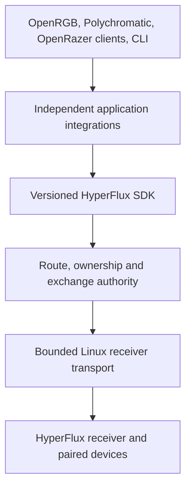
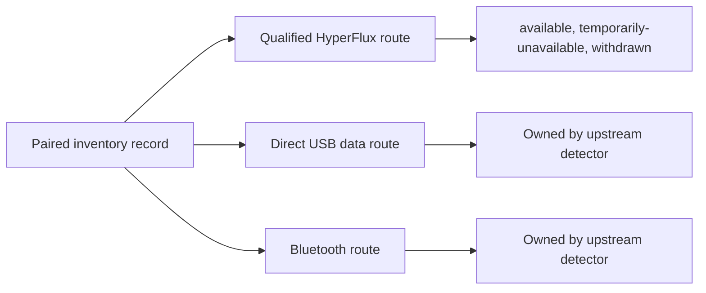
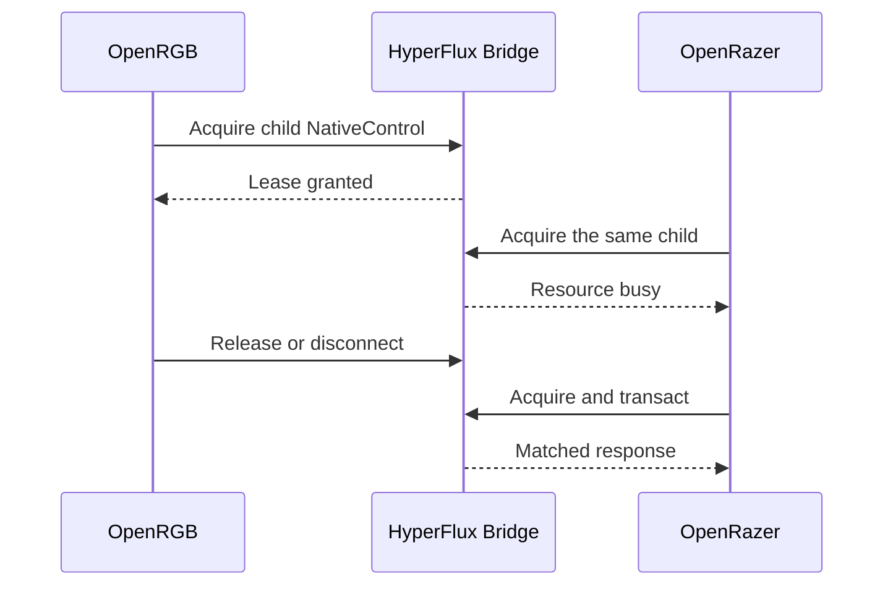

HyperFlux Next: The Complete Design Book
Chapter I: Why The New Repository Exists
1. Purpose
HyperFlux Next should become the universal Linux foundation for devices connected through the HyperFlux V2 system. A normal user should install one package, receive a working driver and bridge, open a supported application, and see the devices that are actually usable. A developer should be able to add support for another qualified device without editing unrelated kernel code, application widgets, packaging scripts, documentation tables, and validation programs independently. The product must remain useful even when the user owns only a mouse, only a keyboard, a different supported model, another mat edition, another Linux distribution, or no RGB application at all.
2. Relationship To The Current Repository
The current repository should be treated as a research archive rather than the architectural template for the future. It contains valuable discoveries, but it also contains designs created while we were still learning what the receiver does. The new repository should inspect each behavior deliberately and ask: is this proven, is its implementation healthy, and does it belong at this architectural layer? Proven behavior may be ported; proven behavior inside weak code should be rewritten; duplicated information should be generated; experiments should be archived; unsafe assumptions should be rejected. This prevents us from carrying yesterday’s uncertainty into tomorrow’s foundation.
3. Knowledge That Must Be Preserved
The migration must preserve receiver report discoveries, validated identities, LED mappings, transaction framing, generation rules, battery observations, sleep and wake behavior, reconnect behavior, package lifecycle findings, OpenRGB layouts, effects tests, persistence results, and every useful failure analysis. Each preserved claim should link to the evidence that justified it. “The mouse has thirteen addressable LEDs” is not merely copied as a number; it is linked to the physical proof that established wheel, logo, strip length, and ordering. This allows future developers to understand why a rule exists instead of treating old constants as mysterious truth.
4. Complexity That Must Not Be Preserved
We should reject duplicated constants, absolute machine paths, exact device combinations, giant application widgets, test scripts bound to one commit layout, manual lists copied from upstream projects, and validation that repeats twenty minutes of work because of one typo. We should also reject hidden coupling, such as changing OpenRGB presentation and accidentally invalidating package manifests or receiver lifecycle tests. The new repository should preserve observable behavior while redesigning the machinery behind it. Compatibility is valuable; accidental structure is not.
Chapter II: The Architectural Foundation
5. Primary Architecture
The system requires a strict direction of responsibility. OpenRazer and OpenRGB keep the model-specific commands, capabilities, settings, layouts, effects, and persistence they already use for direct devices. HyperFlux replaces only the missing route through the receiver: it qualifies the child, arbitrates one native owner, carries one fixed upstream Feature report, and returns the matching response without interpreting device semantics.

This structure gives us replaceable applications above a stable hardware foundation. Upstream applications continue to construct standard Razer reports, while the SDK hides local framing and the bridge and kernel hide receiver generations, carrier transport, correlation, and failure certainty.
6. Kernel Responsibility
The kernel driver should perform only work that genuinely requires kernel access: binding the verified HID interfaces, preserving ordinary mouse and keyboard input, managing receiver generations, exposing passive observations, enforcing one exclusive writer session, and transporting bounded generation-scoped exchanges. UAPI v2 accepts exactly one qualified 90-byte Feature report, begins its SET at most once, acquires one bounded matching response, and reports transport certainty. It should not implement effects, product names, device commands, application ownership, profile migration, user notifications, package repair, or artwork. Keeping the kernel small reduces crash risk, improves compatibility with future kernels, shortens review, and allows most new functionality to be updated without rebooting.
7. Bridge Responsibility
The bridge is the sole userspace authority allowed to request receiver writes. For the native path it validates the exact route token, receiver generation, declarative report profile, NativeControl ownership, fixed report shape, deadline, queue admission, and response correlation. It reports only `not-sent`, `may-have-been-sent`, or `matched-response` and never converts a device status into success or repeats an uncertain SET. Because every application passes through the same bridge, route safety is implemented once while model behavior remains upstream.
8. Strong Domain Types
The code should stop passing semantically different facts as interchangeable strings and integers. GenerationId, ReceiverId, LogicalDeviceId, RouteToken, EndpointId, LeaseId, TransactionId, ProductId, BatteryPercent, and DurationMs should be separate types with validation. A battery percentage cannot accidentally become a brightness value; a stale generation cannot be passed where a current generation token is required; a wired PID cannot silently authorize a wireless route. This technique makes illegal operations visible during compilation and turns many runtime surprises into immediate developer errors.
Chapter III: Devices, Routes And Truthful State
9. Inventory And Routes
A paired inventory record and a currently authorized route are different objects. One keyboard may be known to the receiver while direct USB, HyperFlux wireless, or Bluetooth data paths change independently.

This distinction prevents paired history from becoming write authority. Inventory can remain useful for diagnostics while a withdrawn HyperFlux route produces no virtual controller. HyperFlux availability does not claim sleep, power-off, physical readiness, or visible application state.
10. Presence State Model
Native route state is deliberately smaller than retail-device state. `available` grants a generation-bound route after explicit route evidence or qualified endpoint-local traffic, `temporarily-unavailable` retains a known identity without accepting a transaction, and `withdrawn` records actual removal from the route inventory or generation. Pairing, silence, sleep labels, power labels, passive battery observations, and input activity remain separate facts unless a profile explicitly qualifies the endpoint-local report as route evidence. HyperFlux never promises that availability proves the child will visibly apply a command.
11. Wired And Wireless Duplicate Handling
OpenRGB and OpenRazer own direct USB devices, while their HyperFlux transport adapters own receiver-backed routes. Direct USB takes precedence only when a nonempty serial queried from the physical direct route exactly matches the receiver-backed child. HyperFlux withdraws that one virtual route and recreates it after the direct data route disappears. It never deduplicates by PID, model name, or device kind, and a wall-power cable without a data route changes nothing.
12. Composable Hardware Profiles
The current style of one receiver plus one exact keyboard plus one exact mouse should be replaced by composition. A qualified receiver profile describes receiver behavior. Independent child profiles describe each keyboard or mouse. A system profile is assembled at runtime from whichever qualified children are actually paired. This permits mouse-only use, keyboard-only use, another supported mouse with the same receiver, and future devices without creating a combinatorial list of every possible pair.
13. Hard And Cloth Editions
Hard and Cloth should be modeled as surface variants rather than guessed USB identities. If both products use the same receiver protocol and PID, one receiver profile can support both while optional metadata describes the physical surface. If a future observation proves different hardware behavior, a variant profile can override only the relevant properties. The repository must never invent a PID from a product name or use your Hard Edition as proof that every user owns the same edition.
14. Mat And Receiver Presentation
HyperFlux V2 should not appear as an addressable RGB controller unless an upstream application has a real controller and qualified standard report path for it. The mat and receiver still matter as charging, pairing, transport, identity, and diagnostic infrastructure, but those facts do not invent another lighting device. Any future controllable status light must enter through a source-bound upstream model and qualified native report route, not a HyperFlux-specific semantic API or ambiguous product-page wording.
Chapter IV: Universality And Qualification
15. Support Levels
Support must distinguish upstream model support from HyperFlux transport qualification. A device may be a reviewed candidate or have extensive OpenRazer and OpenRGB knowledge while its receiver route remains non-writable. A native route becomes qualified only when exact receiver-observed identity, source-bound upstream records, a matching fixed report family, response correlation, and physical transport evidence agree. Upstream applications decide which model capabilities to expose after that route exists.
16. Unknown Device Behavior
When the receiver reports an unfamiliar child PID, the system should expose safe identity and passive observations where possible. It must not send commands copied from a similar model or infer route authority from a support list. Privacy-safe local qualification may propose a declarative route profile. Once unchanged upstream reports and matched responses are proven, promoting a same-protocol device changes profile data and upstream bindings without changing the kernel, bridge engine, SDK transport, relay engine, or application transport abstractions.
17. Declarative Transport Profiles
Applications keep their own model capabilities and command logic. HyperFlux profiles declare transport facts such as exact identity, protocol family, fixed report shape, route qualification, and response correlation; they never grant support from a PID list alone. This is the key to universality because another same-protocol device can gain a qualified native route through profile data and upstream bindings without adding model branches to the kernel, bridge, SDK, relay, or application transport adapters.
Chapter V: Application Integrations
18. OpenRGB Integration
OpenRGB receives qualified native routes through a dedicated integration that depends only on HyperFlux SDK protocol v7. The integration instantiates the pinned upstream Razer controller with an alternate Feature transport; OpenRGB remains responsible for commands, modes, layouts, LED labels, geometry, color editing, profiles, effects, and application behavior. HyperFlux supplies exact wireless identity, route availability, generation safety, and an opaque 90-byte request/response exchange. Ordinary hidapi controllers remain unchanged, and serial-proven direct USB takes precedence over only the matching receiver route.
19. OpenRGB Effects
Spectrum Cycling, Rainbow Wave, Breathing, and the broader Effects catalog belong to OpenRGB’s official effect engine. HyperFlux does not recreate or claim those effects. It carries the same upstream-generated Feature reports through a bounded, fair native exchange and returns the matching response unchanged. Tests verify animation continuity, sibling-device independence, rescan behavior, reconnect recovery, and transport latency rather than reimplementing effect mathematics.
20. Application-Owned Persistence
Application lighting persistence belongs to OpenRGB. Stable colors, Off, hardware modes, and software-effect startup profiles are represented and resumed by the upstream application exactly as they are for direct devices. HyperFlux reports route loss and return without inventing sleep state, retaining colors, replaying wake frames, or promising a wake-color deadline. Its contract is that the first valid upstream transaction after a writable return is transported without an intentional restoration timer.
21. OpenRazer Native Route
OpenRazer contains the device classes, method lists, images, settings, persistence rules, and command construction that its clients already expect. HyperFlux imports source-bound identity and transport facts but does not duplicate those semantics. A narrow pinned source transform lets the official OpenRazer driver send its unchanged 90-byte Feature reports through trusted feature-only UHID routes while preserving the ordinary USB path for direct devices.
22. Migration org.razer Compatibility Provider
The private HyperFlux org.razer compatibility provider is retained as a migration fallback while native-route physical parity is incomplete. It is isolated, opt-in, and prevented from competing with a native-control session. Removing it requires complete method and hardware parity plus a separate approval gate; it is not part of the final native path.
23. Polychromatic Through OpenRazer
Polychromatic continues to use its ordinary OpenRazer backend, official D-Bus API, device presentation, and controls. Receiver-backed devices appear through the patched OpenRazer transport just like the corresponding wireless class. The custom HyperFlux Polychromatic backend remains only as a noncompeting migration fallback until the same parity and retirement gates pass.
24. Upstream Device Settings
Lighting is only one part of the upstream experience. DPI stages, independent X/Y DPI, polling rate, acceleration, scroll behavior, Smart Reel, idle timeout, low-battery threshold, gaming mode, macros, brightness, charging state, pairing, and future model behavior remain owned by OpenRazer or OpenRGB. HyperFlux qualifies whether unchanged reports and matching responses cross a route; it does not add one semantic SDK method or receiver translation per setting. A different report format is an explicit backend requirement rather than a guessed rewrite.
Chapter VI: Application Ownership
25. Native Control Ownership
Multiple applications must not send native and migration-path commands to the same child concurrently. The bridge issues a generation-bound NativeControl lease for one exact receiver route. It conflicts with retained semantic lighting, settings, and pairing resources for that child only; siblings, other receivers, and newer generations remain independent.

Read-only route discovery, battery, and availability information remain shared. This prevents write conflicts without making applications blind to one another.
26. Ownership User Experience
Adapters surface a stable resource-busy result when another native or migration session owns the same child. Diagnostics identify the owning client without claiming that a particular device setting is controlled. Adapter disconnect, route withdrawal, generation replacement, or an explicit release ends the lease; forced takeover is prohibited.
27. Atomic Native Exchanges
Each native exchange is atomic at the route boundary: one SET begins at most once, one matching response is returned at most once, and an uncertain SET is never automatically repeated. Multi-device effects and grouped settings remain application behavior. The bridge preserves bounded per-route FIFO ordering and fair sibling dispatch without interpreting or combining upstream commands.
Chapter VII: Schemas, SDKs And Reuse
28. Schema-First Development
Requests, responses, events, profiles, capabilities, errors, diagnostics, evidence, and test definitions should begin as versioned schemas. The schema is reviewed before implementations diverge. It defines required fields, bounded values, compatibility rules, privacy classifications, and extension points. This replaces informal agreements hidden across Rust, C++, Python, shell, YAML, and documentation.
29. Generated Code
A profile compiler should generate Rust types, C++ SDK structures, Python models, kernel tables, validators, documentation tables, and fixtures from canonical sources. Generated files carry source hashes and warnings that they must not be edited manually. CI regenerates them and fails when committed output is stale. A corrected product name or capability identifier is changed once and propagated safely, eliminating the repeated-edit pattern that currently makes small updates dangerous.
30. Stable HyperFlux SDK
The SDK is the supported contract for integrations. Protocol v6 preserves logical-device discovery, semantic migration APIs, telemetry, ownership, and diagnostics. Protocol v7 adds qualified native-route enumeration, bounded availability events, NativeControl ownership, and exact fixed-size Feature exchanges while still hiding socket framing, credentials, receiver carrier frames, and bridge-internal actors. C++, Rust, and Python clients share generated protocol types and language-appropriate convenience APIs.
31. Feature Negotiation
When a client connects, it announces its protocol range and optional features. The bridge responds with the mutually supported version and capabilities. A newer bridge can continue serving an older OpenRGB plugin when the required contract remains compatible. A genuinely incompatible client receives a clear structured error explaining which component needs updating. This prevents a package upgrade from producing unexplained missing devices because two binaries silently disagree about a field.
32. Interfaces And Dependency Injection
Core logic should depend on interfaces such as ReceiverTransport, Clock, ProfileRegistry, LeaseManager, PersistenceStore, and EventSink. Production supplies real implementations; tests supply deterministic substitutes. A simulated clock can advance fourteen minutes instantly. A failing persistence store can reproduce disk errors. A virtual transport can disconnect exactly between two frames. This makes difficult lifecycle paths ordinary automated tests instead of rare manual accidents.
33. Explicit State Machines
Receiver lifecycle, native-route availability, application ownership, and transactions should each have declared states and valid transitions. The retained semantic restoration fallback has its own isolated state machine until its removal gate passes. A transaction cannot move from Created directly to Delivered; it must be validated, ownership-bound, generation-bound, queued, sent, and terminally recorded. A stale generation cannot return to Active. A released lease cannot authorize another write. Encoding these rules explicitly makes reviews and tests far more reliable than scattered boolean conditions.
34. Event Subscriptions
Applications subscribe to typed events such as RouteAvailable, RouteTemporarilyUnavailable, RouteWithdrawn, BatteryUpdated, OwnershipChanged, GenerationReplaced, and TransactionCompleted. Availability events do not claim sleep, power-off, or child application state. Events contain sequence numbers and current-state references so a client can detect gaps and request a fresh snapshot.
35. Bounded Concurrency And Backpressure
Every queue, journal, event buffer, and native route must have a defined limit and overflow policy. Native exchanges retain route-local FIFO ordering, fair sibling service, deadlines, and explicit certainty; once SET starts, an uncertain operation is never coalesced or automatically repeated. Slow clients must not block the receiver actor, and logging must never wait forever for an unread pipe. Backpressure becomes a structured not-sent result before dispatch.
Chapter VIII: Simulation And Verification
36. Virtual Receiver
The simulator should implement the same interface as the real kernel-backed transport. It can create arbitrary receiver generations, pair different children, emit battery reports, withdraw and return routes, delay or mismatch responses, corrupt reports, and simulate suspend. It may replay a captured child-sleep scenario without turning that observation into a production availability claim. Because the bridge cannot tell whether it is connected to real or virtual transport through the interface, almost every policy path can be tested without hardware.
37. Deterministic Replay
Privacy-safe structured evidence from physical runs becomes immutable replay fixtures. A fixture can reproduce the exact order of observations that once caused a mouse wake failure or a reconnect-generation bug. Simulated time and deterministic random seeds make failures reproducible. When a defect is fixed, its replay becomes a permanent regression test. Raw serials and unnecessary payloads are excluded so fixtures can safely live in the repository.
38. One Verification Entry Point
Developers and CI should use one memorable command:
hfx verify --all
This command invokes a typed dependency graph rather than one enormous script. It understands which tools, builds, schemas, fixtures, packages, applications, and hardware stages are relevant. A failed OpenRGB contract does not erase successful kernel results, and rerunning an unchanged stage reuses its verified artifact.
39. Fast Verification
The fast lane runs formatting, linting, schema validation, generated-file freshness, unit tests, basic property tests, documentation examples, and a representative simulator smoke test. It should complete quickly enough to run before every commit. Fast feedback prevents developers from accumulating ten interacting mistakes before CI finally reports them.
40. Full Software Verification
The full software lane builds supported kernel configurations, Rust services, C++ integrations, Python clients, packages, documentation, and simulator scenarios. It runs application contracts, lifecycle replay, installation, upgrade, rollback, security, license, compatibility, and performance checks. It requires no physical device and should catch the majority of regressions before asking you to observe hardware.
41. Hardware Qualification
Physical testing is reserved for claims software cannot prove: a new command’s visible effect, an unknown PID, LED ordering, sleep timing, battery meaning, charging behavior, or receiver-specific lifecycle behavior. The test planner compares changed source domains with capability evidence and selects only affected physical scenarios. A documentation or widget-layout change must never trigger a twenty-minute passive mouse proof.
42. Watched-Test Application
The physical coordinator should become a proper terminal interface with numbered selections, visible checkpoints, timers, device readiness, and precise instructions. Before any write, it validates repository head, artifacts, manifests, module state, receiver generation, configuration, and authorization. A misspelled answer is rejected locally without repeating a transaction. Interrupted work resumes from the last compatible checkpoint rather than starting from the baseline.
43. Typed Test Metadata
Every test declares its identity, owned domain, required capabilities, hardware requirement, whether it performs writes, expected duration, timeout, dependencies, isolation needs, cache inputs, produced evidence, and resume policy. The orchestrator can then answer why a test is running and what invalidated its cache. This replaces hard-coded test lists spread across workflows and shell scripts.
44. Verification Outputs
Each run produces a concise human report and structured machine artifacts: JSON results, JUnit, GitHub annotations, performance measurements, generated-file checks, package hashes, and an evidence manifest. The manifest binds results to source, schemas, profiles, dependencies, simulator fixtures, compiler versions, and hardware generations where applicable. A green badge then represents a specific reproducible candidate rather than an ambiguous workflow completion.
45. Advanced Testing Methods
Unit tests verify local behavior. Integration tests verify real components together. Contract tests hold every adapter to the same SDK rules. Golden and snapshot tests detect layout or generated-data drift. Property tests generate unexpected combinations. Fuzzers attack parsers and migrations. Mutation testing deliberately changes conditions to prove tests notice. Fault injection introduces crashes, stale sockets, permission errors, delayed responses, disk failures, and interrupted package hooks.
46. Formal Model Checking
Some invariants deserve more than examples. A small TLA+ or equivalent model can explore every ordering of lease acquisition, receiver reconnect, frame delivery, and application crash. It can prove that two applications never simultaneously own one resource or reveal a counterexample where a stale generation writes. Formal methods should target high-risk concurrent protocols, not every ordinary function.
47. Language-Specific Tooling
Rust can use Clippy, nextest, proptest, cargo-fuzz, cargo-mutants, cargo-deny, and API compatibility checks. Python can use uv, Ruff, mypy, pytest, and Hypothesis. C++ can use CMake presets, clang-tidy, sanitizers, and Include-What-You-Use. Kernel code can use sparse, Smatch, Coccinelle, KUnit, KASAN, and KCSAN. Tools are adopted because they catch a defined failure class, not merely because they look advanced.
Chapter IX: User Experience And Diagnostics
48. Declarative Application UI
Application interfaces should consume tested view models rather than interpreting raw bridge responses inside large widget classes. The view model decides labels, available actions, ownership, battery freshness, route availability, and qualification level. The widget renders that model. This allows us to test “the keyboard route is temporarily unavailable while OpenRGB retains its profile” without launching hardware, and it prevents a visual redesign from changing receiver policy.
49. Central Error Catalog
Every error should be defined once with a stable identifier, severity, technical cause, user explanation, safe action, verification method, privacy classification, and documentation link. Doctor, service logs, OpenRGB, Polychromatic, package hooks, and support bundles all render the same underlying finding. Changing the explanation for a service failure no longer requires editing five separate implementations.
50. Doctor
Doctor should answer three questions: what works, what requires attention, and what the user should do next. It may automatically repair safe states such as restarting a compatible inactive service. It must not silently unload an active kernel module, reconnect hardware, change pairing, or enable writes. Detailed internals remain available through an explain mode, while the default output stays understandable for an ordinary user.
51. Privacy-Safe Support Bundles
A support preview should describe exactly what would be collected. Bundles include package state, kernel compatibility, bridge state, bounded receiver generations, capability qualification, structured outcomes, and relevant typed errors. They exclude hardware serials, stable host identifiers, private paths, arbitrary terminal history, raw reports, captures, and memory dumps by default. Active queries and hardware writes require separate authorization and are recorded explicitly.
Chapter X: Updates, Packaging And Operations
52. Configuration Migrations
Every persisted configuration carries a schema version. An upgrade computes a migration plan, writes the new version transactionally, validates it, and retains a rollback copy until the new service starts successfully. Unsupported downgrades are explained before damage occurs. Integrations store their own presentation settings separately from bridge safety policy so updating OpenRGB does not rewrite receiver configuration.
53. Package Lifecycle
Packages must be tested from the perspective of an ordinary user: fresh installation, reinstall, compatible update, driver-changing update, service activation, configuration preservation, application adapter reload, rollback, and uninstall. Package hooks should be short and deterministic. Complex decisions belong in a tested activation utility rather than embedded shell fragments.
54. Kernel Activation
Linux cannot replace an in-use kernel module invisibly. When only userspace changes, the bridge may restart automatically. When the installed module differs from the loaded module, the safe choices are reboot or receiver disconnection followed by module reload and reconnection. The package should detect this accurately and present one action. It should never call a required reboot a mysterious service failure.
55. Reproducible Development Environment
Compiler, Rust, Python, CMake, schema compiler, OpenRGB SDK, OpenRazer metadata, and test-tool versions should be pinned. A Nix environment or development container can reproduce the toolchain locally and in CI. Language lockfiles remain committed. Developers can still use their preferred editor, but builds no longer depend on unrecorded tools installed on one workstation.
56. Supply-Chain Security
Dependencies are reviewed, pinned, licensed, and scanned. Packages produce SPDX or CycloneDX software bills of materials. Build provenance records source and toolchain inputs. GitHub Actions are pinned by commit. Future releases can use signed tags, packages, Sigstore attestations, and SLSA provenance. Imported upstream catalogs record source hashes so an unnoticed upstream change cannot silently alter supported devices.
57. Performance Budgets
Performance becomes a tested contract. The repository defines acceptable bridge startup time, transaction latency, effect-frame delay, reconnect recovery, queue depth, CPU use, memory use, binary growth, and package size. A change that technically passes but makes Rainbow Wave visibly stutter is not considered successful. Historical benchmark trends help distinguish noise from meaningful regression.
Chapter XI: Automation, Documentation And GitHub
58. Change-Aware CI
CI should derive affected domains from a maintained dependency graph. A schema change runs every generated binding and adapter contract. A kernel change runs kernel builds, UAPI compatibility, package activation, and relevant lifecycle simulations. A documentation change runs links, examples, generation, accessibility, and portal builds. Change awareness reduces wasted time without weakening required checks.
59. Dependency Updates
Renovate or Dependabot can group related updates and open reviewable pull requests. Each update reports API compatibility, schema changes, license changes, vulnerabilities, binary-size movement, performance impact, and selected tests. Automatic merging is reserved for narrowly defined low-risk updates with complete green evidence. Upstream OpenRGB or OpenRazer metadata changes generate a proposed diff rather than silently entering production.
60. Documentation Portal
The GitHub Pages site should serve different audiences without mixing them. Users receive installation, applications, supported devices, troubleshooting, privacy, and updates. Developers receive architecture, SDK, schemas, state machines, profiles, testing, and contribution guidance. Maintainers receive qualification evidence, release gates, migrations, and operational policy. Support tables and diagrams should be generated from real registries so documentation cannot drift quietly.
61. GitHub Repository Experience
The repository should use meaningful navigation, architecture decision records, issue forms, pull-request impact summaries, CODEOWNERS, protected main, linear history, dependency graphs, private vulnerability reporting, generated changelogs, and compatibility dashboards. Visual polish should communicate live truth rather than decorative badges. A visitor should quickly understand what HyperFlux does, what hardware is qualified, what remains experimental, and how to obtain useful support.
Chapter XII: Migration And Release
62. Migration Ledger
Every old component receives an explicit decision and rationale. The ledger records whether it is ported, rewritten, replaced, generated, archived, rejected, or still under investigation. It links old evidence to new tests and names the new architectural owner. This gives the migration an end condition and prevents forgotten scripts or undocumented behavior from resurfacing later.
63. Shadow Comparison
Before the new system controls real hardware, it can process recorded observations beside the old implementation and compare selected profiles, route states, transaction validation, certainty, and diagnostic findings. Shadow mode remains read-only. The old and new implementations must never both hold the writer session because comparison must not become competing hardware control.
64. Migration Order
The order should reduce uncertainty before moving dangerous behavior.

```mermaid
flowchart LR
    Rules["Architecture constitution"] --> Schemas["Schemas and domain types"]
    Schemas --> Sim["Simulator and replay"]
    Sim --> Core["Native exchange core"]
    Core --> Razer["OpenRazer native route"]
    Razer --> RGB["OpenRGB native route"]
    RGB --> Own["Native control arbitration"]
    Own --> Parity["Physical parity"]
    Parity --> Compat["Fallback retirement gate"]
    Compat --> Package["Packaging and diagnostics"]
    Package --> HW["Targeted hardware qualification"]
    HW --> RC["Release candidate"]
```

Each upstream adapter moves only after the native exchange core and its application-specific transport boundary pass software contracts. Migration fallbacks remain installed but cannot compete with NativeControl. They are removed only after physical parity, rollback, and an explicit retirement approval.
65. Release Channels
Development builds may contain incomplete migrations. Nightly builds require complete software verification. Release candidates require installation, upgrade, lifecycle, application, and selected physical evidence. Stable releases require approved evidence, reproducible artifacts, documentation, known-limit declarations, and no unresolved release-blocking findings. A successful compile is never treated as publication authorization.
66. Limits And Epistemic Honesty
No architecture can guarantee that every future Razer device uses the same receiver commands. No simulator can prove a previously unseen physical effect. No upstream support list can substitute for transport qualification. The system should make these limits visible through support levels and evidence, not hide them behind broad claims. The innovation is not pretending uncertainty disappears; it is containing uncertainty so one unknown device cannot destabilize proven support.
67. Final Definition Of Success
HyperFlux Next succeeds when the foundation is calm even as integrations evolve. Adding a same-protocol device means adding one composable route profile, source-bound upstream bindings, and focused qualification evidence without changing the kernel, bridge engine, SDK transport, relay engine, or application transport abstractions. OpenRGB and OpenRazer-based clients coexist through exact route ownership while direct devices remain untouched. Wired and wireless routes are truthful. Updates preserve configuration and automate everything that is safe. Most failures are caught by simulation before the receiver is touched, and physical validation proves only the remaining transport unknowns.
This is the complete expanded form of all 67 subjects. It explains what each mechanism is, why it exists, how it should behave, how it affects users and developers, and where physical evidence remains necessary.
