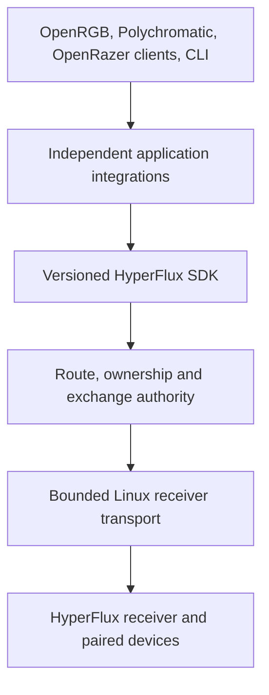

# Design Book Chapter II: The Architectural Foundation

This chapter is part of the [HyperFlux Next Design Book](../design-book.md).

Every layer between an application and the receiver could, in principle, learn about device
models, lighting effects, and receiver framing. If they all did, a change for one device
would ripple through the kernel, the bridge, and every application. This chapter fixes which
layer owns what, so that model knowledge stays in OpenRazer and OpenRGB and HyperFlux
supplies only the missing route through the receiver. A route is the bridge's handle for one
device on one receiver connection; a generation is one physical connection of the receiver,
and a replug starts a new one.

## 5. Primary Architecture

The system requires a strict direction of responsibility. OpenRazer and OpenRGB
keep the model-specific commands, capabilities, settings, layouts, effects, and
persistence they already use for direct devices. HyperFlux replaces only the
missing route through the receiver: it qualifies the child, arbitrates one
native owner, carries one fixed upstream Feature report, and returns the
matching response without interpreting device semantics.

This structure gives us replaceable applications above a stable hardware
foundation. Upstream applications continue to construct standard Razer reports,
while the SDK hides local framing and the bridge and kernel hide receiver
generations, carrier transport, correlation, and failure certainty. The cost is that
HyperFlux cannot change how a model behaves; that remains the upstream project's work.

## 6. Kernel Responsibility

The kernel driver performs only work that requires kernel access: binding
verified HID interfaces, preserving ordinary mouse and keyboard input, managing
receiver generations, exposing passive observations, enforcing one exclusive
writer session, and transporting bounded generation-scoped exchanges. UAPI v2
accepts exactly one qualified 90-byte Feature report, begins its SET at most
once, acquires one bounded matching response, and reports transport certainty.
It also publishes bridge-forwarded battery state in power_supply; never queries:
the bridge's writer file forwards each child lane's decoded capacity, status,
and bounded model name, and the kernel registers one device-scoped battery per
lane until the bridge reports the child gone or the writer file closes.
Effects, product name tables, application ownership, profile migration,
notifications, package repair, and artwork remain outside the kernel.

## 7. Bridge Responsibility

The bridge is the sole userspace authority allowed to request receiver writes.
For the native path it validates the exact route token, receiver generation,
declarative report profile, NativeControl ownership, fixed report shape,
deadline, queue admission, and response correlation. It reports only `not-sent`,
`may-have-been-sent`, or `matched-response` and never converts a device status
into success or repeats an uncertain SET. Because every application passes
through the same bridge, route safety is implemented once while model behavior
remains upstream.

## 8. Strong Domain Types

`GenerationId`, `ReceiverId`, `LogicalDeviceId`, `RouteToken`, `EndpointId`,
`LeaseId`, `TransactionId`, `ProductId`, `BatteryPercent`, and `DurationMs` are
distinct validated domain types. This prevents a battery value from becoming
brightness, a stale generation from authorizing a current route, or a wired PID
from silently authorizing a wireless child.

---

- Previous: [Chapter I: Product Foundations](01-product-foundations.md)
- [Design Book index](../design-book.md)
- Next:
  [Chapter III: Devices, Routes And Truthful State](03-devices-routes-and-truthful-state.md)
