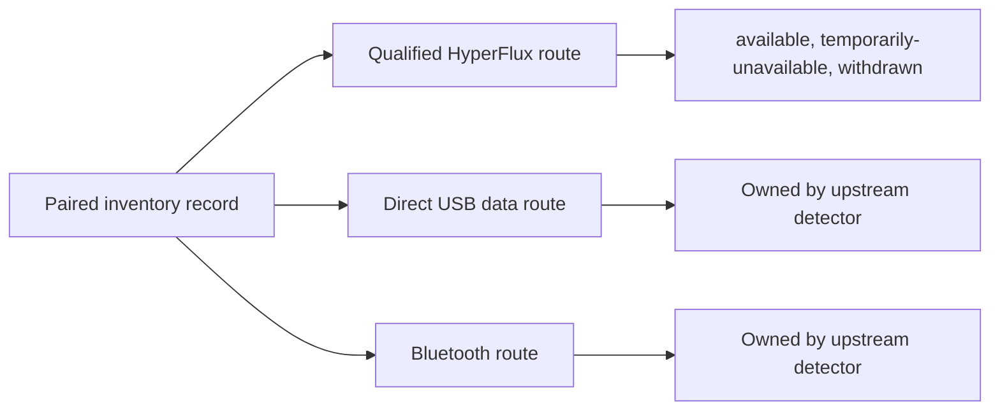

# Design Book Chapter III: Devices, Routes And Truthful State

This chapter is part of the [HyperFlux Next Design Book](../design-book.md).

A receiver remembers which devices are paired with it, but a paired device may be asleep,
switched off, or plugged in by cable. If HyperFlux treated paired as ready, it would send
writes that go nowhere and show devices that are not there. This chapter separates what is
known about a device from whether it can be written to right now.

## 9. Inventory And Routes

A paired inventory record and a currently authorized route are different
objects. One keyboard may be known to the receiver while direct USB, HyperFlux
wireless, or Bluetooth data paths change independently.

This distinction prevents paired history from becoming write authority.
Inventory can remain useful for diagnostics while a withdrawn HyperFlux route
produces no virtual controller. HyperFlux availability does not claim sleep,
power-off, physical readiness, or visible application state.

## 10. Presence State Model

Native route state is deliberately smaller than retail-device state. `available`
grants a generation-bound route after explicit route evidence or qualified
endpoint-local traffic, `temporarily-unavailable` retains a known identity
without accepting a transaction, and `withdrawn` records actual removal from the
route inventory or generation. Pairing, silence, sleep labels, power labels,
passive battery observations, and input activity remain separate facts unless a
profile explicitly qualifies the endpoint-local report as route evidence.
HyperFlux never promises that availability proves the child will visibly apply a
command.

## 11. Wired And Wireless Duplicate Handling

OpenRGB and OpenRazer own direct USB devices, while their HyperFlux transport
adapters own receiver-backed routes. Direct USB takes precedence only when a
nonempty serial queried from the physical direct route exactly matches the
receiver-backed child. HyperFlux withdraws that one virtual route and recreates
it after the direct data route disappears. It never deduplicates by PID, model
name, or device kind, and a wall-power cable without a data route changes
nothing.

## 12. Composable Hardware Profiles

A qualified receiver profile describes receiver behavior, and independent child
profiles describe each keyboard or mouse. Runtime composition uses whichever
qualified children are actually paired. No exact keyboard-plus-mouse combination
is required.

## 13. Hard And Cloth Editions

Hard and Cloth are surface variants, not guessed USB identities. Shared protocol
and PID facts remain in the receiver profile; a future evidence-backed
behavioral difference can add a narrow variant override. A product name or one
physically tested edition never invents identity for another edition.

## 14. Mat And Receiver Presentation

HyperFlux V2 is not published as an addressable RGB controller unless an
upstream application has a real controller and qualified standard report path
for it. Charging, pairing, transport, identity, and diagnostics do not invent a
third lighting device. Any future controllable status light requires a
source-bound upstream model and qualified native route.

---

- Previous:
  [Chapter II: The Architectural Foundation](02-architectural-foundation.md)
- [Design Book index](../design-book.md)
- Next:
  [Chapter IV: Universality And Qualification](04-universality-and-qualification.md)
