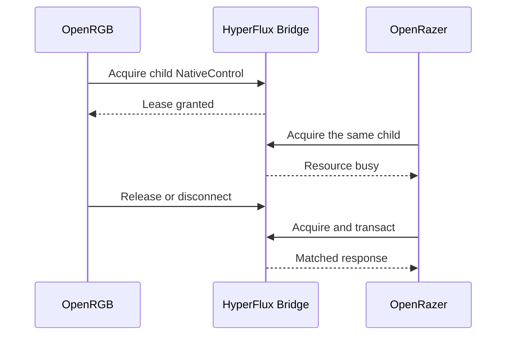

# Design Book Chapter VI: Application Ownership

This chapter is part of the [HyperFlux Next Design Book](../design-book.md).

Two applications writing to the same device at once can leave it in a state neither of them
asked for. This chapter describes how the bridge gives one application control of one device
at a time, how users see who is in control, and how each exchange stays whole.

## 25. Native Control Ownership

Multiple applications must not send native and migration-path commands to the
same child concurrently. The bridge issues a generation-bound NativeControl
lease for one exact receiver route. It conflicts with retained semantic
lighting, settings, and pairing resources for that child only; siblings, other
receivers, and newer generations remain independent.

Read-only route discovery, battery, and availability information remain shared.
This prevents write conflicts without making applications blind to one another.

## 26. Ownership User Experience

Adapters surface a stable resource-busy result when another native or migration
session owns the same child. Diagnostics identify the owning client without
claiming that a particular device setting is controlled. Adapter disconnect,
route withdrawal, generation replacement, or an explicit release ends the lease;
forced takeover is prohibited.

## 27. Atomic Native Exchanges

Each native exchange is atomic at the route boundary: one SET begins at most
once, one matching response is returned at most once, and an uncertain SET is
never automatically repeated. Multi-device effects and grouped settings remain
application behavior. The bridge preserves bounded per-route FIFO ordering and
fair sibling dispatch without interpreting or combining upstream commands.

---

- Previous:
  [Chapter V: Application Integrations](05-application-integrations.md)
- [Design Book index](../design-book.md)
- Next: [Chapter VII: Schemas, SDKs And Reuse](07-schemas-sdks-and-reuse.md)
