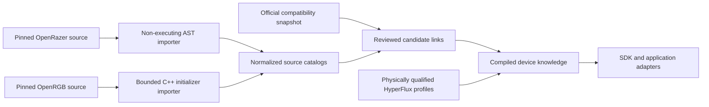

# Device Knowledge Without Transport Guessing

OpenRazer and OpenRGB describe many Razer models, and it is tempting to assume that a device
they know will work through the receiver. It may not: the receiver path is a different
transport from the direct one. This page describes how HyperFlux uses upstream records
without guessing a transport for a device.

HyperFlux Next keeps three different questions separate:

1. What does a named Razer device document or expose on a direct route?
2. Which exact upstream records correspond to an official HyperFlux V2 candidate?
3. Which operations can cross the HyperFlux receiver route, and is that backed by
   pinned upstream source or by tests on real hardware?

Those questions are related, but none answers another automatically.

## Canonical Flow



The importers never import Python modules from OpenRazer and never compile or
execute OpenRGB source. They parse only bounded metadata forms from exact Git
commits declared in `integrations/catalog.json`. Normalized catalogs are
committed, so ordinary builds do not use the network.

Candidate membership is also dated. The original 2026-07-13 snapshot remains
in the repository with its original evidence claim. The 2026-07-21 snapshot
declares that it supersedes that snapshot, preserves every prior candidate
verbatim, and adds one newly reviewed candidate. The knowledge-link catalog
names the exact snapshot it compiles, so repeated candidate IDs cannot silently
blend historical observations.

## What A Source Record Proves

A normalized source record may document:

- exact direct, vendor-receiver, or Bluetooth product IDs;
- matrix dimensions, zones, application slots, and layout keys;
- DPI limits and supported polling rates;
- public methods for battery, idle timeout, low-battery threshold, scroll
  behavior, macros, lighting, and other settings;
- the exact source file, line, revision, digest, and license expression from which each record came.

This is **source-reviewed knowledge**. It is useful for planning, upstream
presentation bindings, native-route qualification, simulator scenarios, and
capability-gap analysis. It is not proof that the same command or packet works
through the HyperFlux receiver.

## What Qualifies A Native Route

`knowledge/capability-map.json` maps upstream method vocabulary to
application-neutral semantic capabilities. For example, `get_dpi_xy` and
`set_dpi_xy` describe `input.dpi-xy`; they do not prescribe an OpenRazer D-Bus
method or an OpenRGB widget.

That map records planning knowledge and upstream disagreement. It does not make
the bridge expose one semantic setting at a time. OpenRazer and OpenRGB decide
which methods and controls their exact upstream device classes provide.

A device reaches one of two writable tiers. Both start from the same identity
conditions:

1. The device is linked explicitly in `knowledge/candidate-links.json`.
2. Receiver observations select an exact wireless VID/PID and one exact child
   profile, not merely a similar product name.
3. Pinned OpenRazer or OpenRGB records bind that identity to a fixed upstream
   protocol family and report shape.

**Source-qualified operational** (`source-qualified-operational`). The route is
listed in `integrations/native-route/source-validated.json`. For at least one
unmodified upstream application, every command that application sends to the
device is matched by a generated command rule, and each rule names the exact
pinned source file, line, and digest it was derived from. The application keeps
generating its own model-specific commands; HyperFlux checks each one against
those rules and carries it through the receiver. Nobody has run the device
through the real-hardware checks, so user-facing pages label it "Expected to
work", and no child-profile controls are offered for it.

**Physically proven** (`physically-proven`). In addition to the above:

4. Public, device-scoped physical evidence proves that upstream command
   semantics, any declared receiver selector translation, and a matching
   standard response cross the receiver route.
5. The profile declares response correlation and native qualification, after
   which protocol v7 and v8 expose only the opaque route and bounded exchange.

Only this tier gets child-profile controls, and user-facing pages label it
"Tested on real hardware".

If the identity conditions hold but no application's commands are fully covered
by command rules, the route is `upstream-blocked-or-research-only`: compiled
knowledge can still explain upstream features and missing evidence, but HyperFlux
sends no lighting changes to it. A promotion between tiers changes profile data,
bindings, evidence, and generated projections; it does not add model branches to
the transport engines.

## Naga V2 Pro Example

The pinned OpenRazer source documents wired `0x00A7` and wireless `0x00A8`
variants, a 30,000 DPI limit, DPI stages, polling, battery, charging, idle
timeout, low-battery threshold, logo lighting, native effects, and custom
frames.

The pinned OpenRGB source independently documents the same PID pair and a
two-slot Logo/Numpad presentation. OpenRazer describes a three-slot matrix. The
compiler reports that topology disagreement rather than choosing whichever
source is convenient.

The official compatibility snapshot `catalog.razer.hyperflux-v2.2026-07-21` lists
the Naga V2 Pro, and compiled knowledge carries the source facts above. That
knowledge alone does not make a route writable. What does is the OpenRGB entry in
the source-validated route catalog: every command OpenRGB sends to the Naga V2 Pro
is covered by a command rule. OpenRazer is not, because its `set_none_effect` and
`set_static_effect` commands have no rule yet. The Naga V2 Pro is therefore
source-qualified operational through OpenRGB only, and
[Supported Hardware](../generated/supported-hardware.md) lists it as "Expected to
work". It has not been physically tested. OpenRGB and OpenRazer generate the model-specific commands
they already own; HyperFlux carries those commands and only declarative receiver
addressing, without copying Naga packet logic into its kernel, bridge, SDK,
relay, or application adapters.

## Update Workflow

The committed catalogs can be reproduced from exact checked-out source trees:

```bash
./hfx knowledge import \
  --openrazer-source /path/to/exact/openrazer/checkout \
  --openrgb-source /path/to/exact/OpenRGB/checkout

./hfx generate
./hfx verify --all
```

An import fails when a checkout revision differs from the integration pin.
Verification also fails if a selected OpenRazer method is unmapped, a link
references a missing record, a candidate is omitted, generated reports are
stale, or source knowledge is accidentally treated as HyperFlux route authority.
