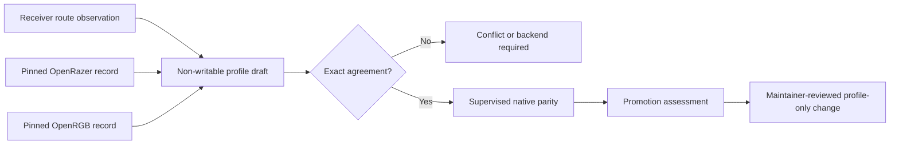

# Native Device Onboarding

Supporting another device should not mean changing the kernel, the bridge, and every
connector, and it must never mean sending commands to a device on a guess.

HyperFlux Next can study another receiver-backed Razer device without adding its
PID to the kernel, bridge, transport engine, or application adapters. The
onboarding path combines a privacy-safe receiver observation with exact records
from the repository's pinned OpenRazer and OpenRGB revisions. It never treats an
upstream support entry as permission to write.

## Authority Flow



The observation supplies only receiver generation, exact VID/PID, device kind,
route state, protocol family, and report size. Serials, route tokens, host
paths, raw feature reports, and stable host identity are excluded.

OpenRazer contributes exact device identity and command-surface knowledge.
OpenRGB contributes exact presentation, layout, zones, and modeled topology. A
difference between those sources is preserved as a conflict; HyperFlux does not
guess which source is physically correct.

## Development Boundary

The installed `hyperfluxctl` deliberately exposes only status, read-only doctor,
bounded support-bundle, and read-only `qualification` report commands. The
report is the `hyperflux-local-qualification-v1` view projected from the
bridge's `snapshot`, `diagnostics`, and `integration-view` answers with
ordinal receiver, device, and generation identifiers; it sends no active
device query, so it can seed an onboarding conversation but is not an
observation. Native route observation remains a source-side verification
facility; it is not installed as an ordinary-user runtime command and cannot
enable a route.

## Maintainer Steps

Create a deterministic draft from one observation:

```sh
./hfx native draft-profile --observation /path/to/observation.json
```

The draft records exact upstream source revisions and digests, source agreement
or disagreement, a proposed profile identifier, and a fail-closed promotion
contract. Its `writable` value is always `false`.

After separate supervised direct-versus-receiver parity evidence exists, assess
whether the candidate is structurally eligible for a profile-only promotion:

```sh
./hfx native assess-promotion \
  --draft /path/to/draft.json \
  --parity /path/to/parity-evidence.json
```

An eligible assessment still grants no authority. A maintainer must review the
exact identity, source pins, method coverage, native parity, and generated
projections before changing canonical profile data.

## Promotion Boundary

A same-protocol device may change only profile data, upstream bindings,
evidence, and generated projections. It inherits receiver-level route-selector
behavior through profile composition and must not require a kernel, bridge,
daemon, SDK transport, OpenRazer relay, or OpenRGB transport-engine change.

If the observed report family or report size differs, the draft is
`backend-required`. If either upstream source lacks an exact record, or if
identity or topology is ambiguous, the draft remains blocked. Existing unknown
candidates remain non-writable.

Native upstream feature reports make a HyperFlux-specific LED carrier map
unnecessary for this route. Existing qualified rollback maps remain in place
until native physical parity passes and maintainer review confirms that removing
them is safe.

## Verification

Run the focused contract and then the selected repository lane:

```sh
python -m unittest tests.test_native_onboarding -v
./hfx verify --fast
```

The focused contract proves private artifact modes, exact source binding,
explicit conflict handling, backend detection, tamper resistance, and a
synthetic second same-protocol device that reaches only a profile-only candidate
state. Physical qualification and release are separate steps.
