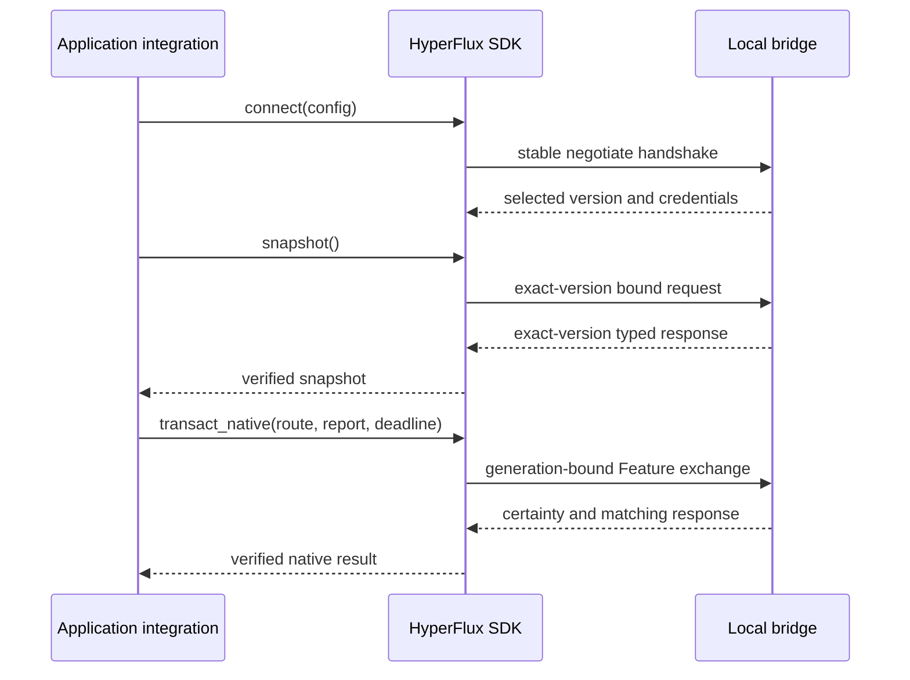

# SDK Boundary

Application integrations use the HyperFlux SDK. They do not construct local RPC frames, retain negotiation credentials, or import bridge implementation modules.

## Responsibilities

The Rust SDK currently owns:

- the stable negotiation handshake and exact-version traffic afterward;
- operating-system-backed request identity generation;
- protocol session ID and negotiation-token binding;
- outer and nested request identity consistency;
- client identity binding for leases, subscriptions, and transactions;
- response request-ID and bridge-instance verification;
- typed clean-EOF, framing, server, and attribution failures;
- ergonomic snapshot, diagnostics, ownership, event, and transaction methods.

Protocol v7 additionally gives native integrations typed methods for:

- enumerating qualified routes with exact wireless identity and opaque tokens;
- watching bounded generation-scoped availability transitions;
- acquiring and releasing one child-local `NativeControl` lease;
- exchanging exactly one qualified 90-byte Feature report with an explicit
  `not-sent`, `may-have-been-sent`, or `matched-response` result.

The SDK does not own hardware profiles, application presentation, device
commands, effects, persistence, ownership policy, queueing, receiver carrier
encoding, or kernel transport. It exposes the native tunnel contract while the
bridge and kernel enforce that contract.

Protocol version 4 adds exact receiver and child profile identities and digests
to snapshots. This lets an integration construct a profile-bound transaction
from bridge authority instead of assuming a receiver model from its local
catalog. Versions 1 through 3 remain frozen; their snapshots normalize without
invented profile digests, so integrations that require writable controllers
negotiate the `snapshot-profile-bindings` feature.

Protocol version 7 preserves every version-6 semantic migration method and adds
the `native-receiver-tunnel` feature independently. Native applications submit
only a fixed report already constructed by their upstream Razer implementation;
they cannot specify USB control setup fields, receiver carrier frames, or an
unqualified destination.

## Failure Rules

A response is accepted only when its request ID matches the outstanding call
and its server instance matches the negotiated bridge process. Clean EOF is
distinct from malformed or truncated input. A semantic or native request that
cannot be represented by the selected protocol fails locally before any prefix
or payload byte is written. A native result with `may-have-been-sent` is never
automatically repeated by the SDK.

Dropping or closing the connection does not transfer authority. The bridge revokes the internal session and then releases associated leases and queued work. Applications reconnect and negotiate new credentials rather than reusing old session values.

## Evolution

The native channel and versioned protocol codec are shared implementation foundations. Generated C++ and future language bindings must reproduce the same public behavior and conformance vectors; they must not call Rust bridge internals or introduce a second protocol definition.
