# Verification

A change to HyperFlux Next can break something far from where it was made, and most of the
code cannot be tried on a real receiver in CI. The verification graph maps each source path
to the checks that cover it, so a change runs the checks it can affect and nothing is
silently skipped. A passing test proves only the behaviour it exercises: software results do
not stand in for results on physical devices.

## Choose A Lane

| You are | Run | What it covers |
| --- | --- | --- |
| Editing code | The focused tests for that code | Fast feedback while you work |
| Opening an ordinary pull request | `./hfx verify --fast --changed-from <commit>` | The checks your change can affect, and everything they depend on |
| Preparing a release candidate | `./hfx verify --full` | The complete software graph |

Hardware work is separate and never runs in hosted CI.

## Safe Change Order

Reduce uncertainty in software before touching hardware. Work through the steps in this
order, and move on only when the earlier steps pass.

```mermaid
flowchart LR
    Rules["Architecture boundaries"] --> Schemas["Schemas and domain types"]
    Schemas --> Sim["Simulator and replay"]
    Sim --> Core["Native exchange core"]
    Core --> Razer["OpenRazer native route"]
    Razer --> RGB["OpenRGB native route"]
    RGB --> Own["Native control arbitration"]
    Own --> Parity["Physical parity"]
    Parity --> Package["Packaging and diagnostics"]
    Package --> HW["Targeted hardware qualification"]
    HW --> RC["Release candidate"]
```

An upstream adapter moves forward only after the native exchange core and its
application-specific transport boundary pass their software contracts. Hardware checks are
kept for the claims software cannot establish, and a release also needs maintainer review
and signed packages.

We chose this order because a mistake found in a schema or the simulator costs one test
run, while the same mistake found on hardware costs a supervised session with a real
receiver.

## Read The Status Badges

The README shows at most three badges:

- **Full verification** reports the latest run of the complete software graph on `main`,
  including package builds and the OpenRGB qualification. It runs on every pull request and
  weekly.
- **CodeQL** reports static analysis on `main`.
- **License** is static.

The changed-path fast lane gates ordinary pull requests but has no badge, because it does
not cover the whole graph.

## Look Up The Current Checks

The generated [verification graph](../generated/verification.md),
[design coverage](../generated/design-coverage.md), and
[release gates](../generated/release-gates.md) show the current state.
