```mermaid
flowchart LR
    Rules["Architecture boundaries"] --> Schemas["Schemas and domain types"]
    Schemas --> Sim["Simulator and replay"]
    Sim --> Core["Native exchange core"]
    Core --> Razer["OpenRazer native route"]
    Razer --> RGB["OpenRGB native route"]
    RGB --> Own["Native control arbitration"]
    Own --> Parity["Physical parity"]
    Parity --> Package["Packaging and diagnostics"]
    Package --> HW["Targeted hardware qualification"]
    HW --> RC["Release candidate"]
```

# Verification

The verification graph maps source ownership to bounded checks. A passing test
proves only the behavior it exercises; software results do not substitute for
physical device results.

## Development Lanes

Use focused tests while editing, changed-path verification for ordinary pull
requests, and the complete software graph for release candidates. Hardware work
is separate and never runs in hosted CI.

## Safe Change Order

Reduce uncertainty in software before touching hardware. Work through the
steps in this order, and move on only when the earlier steps pass.

An upstream adapter advances only after the native exchange core and its
application-specific transport boundary pass software contracts. Physical
qualification is reserved for claims that software cannot establish, and package
publication remains separately authorized.

## Status Badges

The README shows at most three badges. **Full verification** reports the latest
run of the complete software graph on `main`, including package builds and the
OpenRGB qualification; it runs on every pull request and weekly. **CodeQL**
reports static analysis on `main`. **License** is static. The changed-path Fast
lane gates ordinary pull requests and is not shown as a badge, because it does
not cover the whole graph.

## References

The generated [verification graph](../generated/verification.md),
[design coverage](../generated/design-coverage.md), and
[release gates](../generated/release-gates.md) provide the current factual view.
