# Verification

A change to HyperFlux Next can break something far from where it was made, and most of the
code cannot be tried on a real receiver in CI. The verification graph maps each source path
to the checks that cover it, so a change runs the checks it can affect and nothing is
silently skipped. A passing test proves only the behaviour it exercises: software results do
not stand in for results on physical devices.

## Choose A Lane

| You are | Run | What it covers |
| --- | --- | --- |
| Editing code | The focused tests for that code | Fast feedback while you work |
| Opening an ordinary pull request | `./hfx verify --fast --changed-from <commit>` | The checks your change can affect, and everything they depend on |
| Preparing a release candidate | `./hfx verify --full` | The complete software graph |

Hardware work is separate and never runs in hosted CI.

## Safe Change Order

Reduce uncertainty in software before touching hardware. Work through the steps in this
order, and move on only when the earlier steps pass.

```mermaid
flowchart LR
    Rules["Architecture boundaries"] --> Schemas["Schemas and domain types"]
    Schemas --> Sim["Simulator and replay"]
    Sim --> Core["Native exchange core"]
    Core --> Razer["OpenRazer native route"]
    Razer --> RGB["OpenRGB native route"]
    RGB --> Own["Native control arbitration"]
    Own --> Parity["Physical parity"]
    Parity --> Package["Packaging and diagnostics"]
    Package --> HW["Targeted hardware qualification"]
    HW --> RC["Release candidate"]
```

An upstream adapter moves forward only after the native exchange core and its
application-specific transport boundary pass their software contracts. Hardware checks are
kept for the claims software cannot establish, and a release also needs maintainer review
and signed packages.

We chose this order because a mistake found in a schema or the simulator costs one test
run, while the same mistake found on hardware costs a supervised session with a real
receiver.

## Read The Status Badges

The README shows at most three badges:

- **Full verification** reports the latest run of the complete software graph on `main`,
  including package builds and the OpenRGB qualification. It runs on every pull request and
  weekly.
- **CodeQL** reports static analysis on `main`.
- **License** is static.

The changed-path fast lane gates ordinary pull requests but has no badge, because it does
not cover the whole graph.

## Keep Rust Coverage From Slipping

The full lane measures Rust coverage with `cargo llvm-cov` and compares the number of lines,
functions and regions that no test reaches with the limits in
[`assurance/rust-coverage.json`](../../assurance/rust-coverage.json). The check fails in two
cases:

- **`uncovered count regressed`**: your change added code that no test reaches. Add tests
  for it. Raising a limit is a manual edit that needs a reason in review.
- **`improved beyond the committed limits`**: your change made more code tested, and the
  limits no longer protect that gain. Run `./hfx coverage tighten` and commit
  `assurance/rust-coverage.json`.

`./hfx coverage tighten` reads `build/rust-coverage-current.json` from your last full run.
To skip the local run, download the `hyperflux-full-evidence` artifact from the pull
request's Full verification run and pass the file with
`./hfx coverage tighten --report PATH`. The command prints the old and new limits for the
commit message. It only ever lowers limits, and it refuses a report that is worse than
them.

Measurements vary a little between machines: CI counts about 3 more lines and regions as
not covered than a fast local machine, because one relay test loop runs a different number
of times. So `tighten` writes each limit a margin above the measurement (5 lines, 5 regions,
0 functions), and the check only asks for tightening when a result beats a limit by more
than 10 lines, 10 regions or 1 function. A limit written on either machine passes on the
other. Only the not-covered limits work this way: `tighten` never changes the minimum
covered counts, and covered counts can rise freely, so pull requests that add tested code
do not have to touch the file. The share of covered code is checked against a fixed
floor taken from the 2.0 release (`ratio_floor`), which `tighten` never changes, so
deleting code that has tests still passes as long as the share stays at or above it.

## Check The Documentation Render

The **Documentation render** check renders every document in Chromium at three widths, in
light and dark themes, with no network. It runs on pull requests that change a document or
a render input, and fails on any layout issue or outbound request. Layout issues include
content wider than the screen, a box that cuts its content off instead of scrolling, and a
table column too narrow for one of its words. Its screenshots are uploaded as the
`hyperflux-documentation-render` artifact.

The committed render record, `assurance/documentation-audit.json`, describes the last
release. Ordinary pull requests check only its structure, so a merged documentation change
never makes another pull request stale. A release pull request into `main` must refresh it:

1. Render the release tree: `./hfx docs render --output build/docs-render-<n>`. In the CI
   image, run `./hfx ci docs-prepare` and then `./hfx ci docs-render`.
2. Bind the record to that render: `./hfx docs bind --render build/docs-render-<n>/render`.
3. List the critical screenshots that changed: `./hfx docs review --render <same path>`.
4. Look at each listed screenshot. Then record the review by naming each file:
   `./hfx docs review --render <same path> --confirm <file> ...`.
5. Check the result as release CI will: `./hfx verify --fast --release-evidence required`.

`./hfx docs review` never marks a screenshot reviewed unless you name it.

## Look Up The Current Checks

The generated [verification graph](../generated/verification.md),
[design coverage](../generated/design-coverage.md), and
[release gates](../generated/release-gates.md) show the current state.
