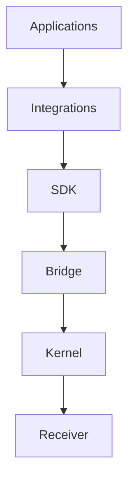

# Architecture Rules

> Generated by `./hfx generate`. Do not edit manually.

This page lists which part of HyperFlux owns what and which way the parts may depend on each other, for contributors who change how the pieces fit together.

Product state: **public-arch-release**

## Which Part Depends On Which

## Which Devices HyperFlux Talks To

The generated receiver authority is exact `1532:00CF` plus 12 official child identities from `catalog.razer.hyperflux-v2.2026-07-21`.
It yields 10 operational child routes. Merged OpenRazer source covers 8 of them and merged OpenRGB source covers 9; 7 are covered by both.
Application admission is decided separately. Hardware assurance records evidence and
does not by itself admit a device or a write.

Direct USB participates only in exact serial-fingerprint precedence. Bluetooth and unrelated USB devices remain outside HyperFlux authority. The complete per-device result is generated in [Supported Hardware](supported-hardware.md).

## Rules That Always Hold

- `HFX-INV-001` Generic mouse and keyboard input remains independent of optional device-control applications.
- `HFX-INV-002` A qualified native integration may submit exactly one fixed upstream Feature report through an opaque route; no application may submit arbitrary USB setup packets, sysfs operations, or receiver carrier frames. The writer file's only other operation forwards bridge-decoded child battery state, which the kernel publishes in power_supply and never sends to the device.
- `HFX-INV-003` One bridge is the sole userspace authority for receiver writes and for child battery state, and one renewable lease owns each writable resource. The kernel publishes bridge-forwarded battery state in power_supply; never queries the device for it.
- `HFX-INV-004` Every native exchange is bound to a live receiver generation, qualified opaque route, declarative report profile, NativeControl owner, deadline, and transaction identity.
- `HFX-INV-005` Native availability is only available, temporarily-unavailable, or withdrawn; pairing, silence, and retail sleep or power labels never grant route authority. Only generation-bound explicit route evidence or endpoint-local traffic qualified by the receiver profile may produce available.
- `HFX-INV-006` Unknown devices expose safe identity and passive observations but inherit no writable capability.
- `HFX-INV-007` Receiver, child, and surface profiles compose independently; no exact mouse and keyboard pair is required.
- `HFX-INV-008` Every queue, journal, event buffer, frame stream, message, and retry policy is explicitly bounded.
- `HFX-INV-009` Only a complete correlated response is matched-response; a possible SET is may-have-been-sent and is never automatically repeated or reported as success.
- `HFX-INV-010` Canonical schemas own shared facts; generated bindings and documentation may not drift from them.
- `HFX-INV-011` Research code, raw captures, private identifiers, machine paths, and source-only physical qualification tools are not product dependencies.
- `HFX-INV-012` No compile, test, package, tag, repository, or green workflow alone grants publication authorization.

## What Each Part Owns

### Applications

Owns: user workflows, device commands and settings, presentation and layouts, profiles, effects, and persistence.

Must not own: receiver carrier encoding, route qualification, kernel access.

### Integrations

Owns: thin Feature-transport adaptation, application contract adaptation, tested route view models.

Must not own: device semantic duplication, receiver carrier transport, profile qualification, uncertain-write retry policy.

### SDK

Owns: version negotiation, qualified native routes, availability events, NativeControl leases, exact fixed-size Feature exchanges, typed errors.

Must not own: application widgets or device commands, receiver carrier frames, raw socket framing in callers.

### Bridge

Owns: route qualification, profile resolution, NativeControl arbitration, bounded native transactions and certainty, availability, diagnostics, retained compatibility fallback.

Must not own: device commands or settings, application presentation, effects, profiles, or persistence, arbitrary USB or receiver reports.

### Kernel

Owns: HID binding, input preservation, receiver generations, passive observations, exclusive writer session, publishes bridge-forwarded battery state in power_supply; never queries, qualified fixed-size native exchange, bounded fallback envelopes.

Must not own: retail names, effects, profiles, application ownership, package repair.

### Profiles

Owns: identity predicates, native report shape and response matching, upstream bindings, route qualification, evidence references, retained fallback mappings.

Must not own: live observations, leases, application desired state, model commands, guessed transport.

### Verification

Owns: typed test graph, simulator, replay, evidence manifests, change selection.

Must not own: production policy, unbounded reruns, implicit hardware authorization.

## Release Checks

Public repository created: **true**

Publication decision recorded: **true**

Required gates:

- `HFX-GATE-FOUNDATION`
- `HFX-GATE-SCHEMAS`
- `HFX-GATE-SIMULATION`
- `HFX-GATE-BRIDGE-SDK`
- `HFX-GATE-KERNEL`
- `HFX-GATE-INTEGRATIONS`
- `HFX-GATE-PACKAGING`
- `HFX-GATE-SOFTWARE`
- `HFX-GATE-HARDWARE`
- `HFX-GATE-PUBLICATION-DECISION`
